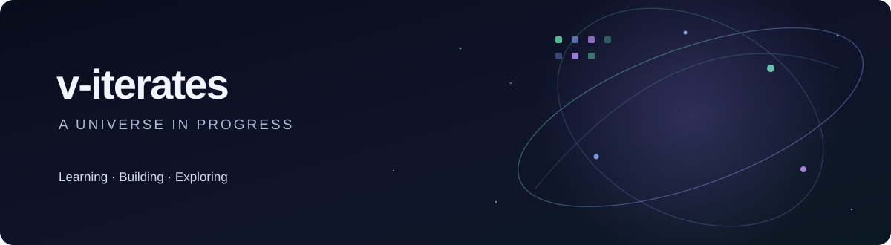

### Code · Curiousity · Creativity · Culture 
### Computer Science · AI & ML · Computer Vision · Web Development

*Learning in public, building with intention, iterating as I go.*

[LinkedIn](https://www.linkedin.com/in/vaishnavi-singh-79a38737a) · [GitHub](https://github.com/v-iterates)

---

## About

I'm a Computer Science undergraduate specialising in **Artificial Intelligence & Machine Learning**. I like understanding how things work, turning ideas into practical experiments, and connecting technical learning with creative problem-solving.

My interests currently orbit around software development, computer vision, intelligent systems, and the craft of building useful things.

## Current orbits

| Orbit | Exploring |
|:--|:--|
| **Software** | C++, Java, SQL, Python, programming fundamentals |
| **Computer vision & AI** | OpenCV, object detection, distance estimation, AI/ML foundations |
| **Web & backend** | HTML, CSS, JavaScript fundamentals, FastAPI, SQLAlchemy, MySQL |
| **Creative systems** | UI/UX, Figma, visual design, technical writing |

## Selected projects

| Project | What I'm exploring |
|:--|:--|
| **OpenCV Object Distance Tracking** | Webcam-based colour segmentation and object-distance estimation, with calibration and smoothing. |
| **EcoQuest** | A gamified environmental-education concept and prototype developed for the Smart India Hackathon. |
| **Lexora** | A Java and MySQL language-learning platform concept with learner, instructor and admin workflows. |
| **Capacity Connect** | A digital learning platform; hands-on work with FastAPI routes, SQLAlchemy and database integration. |

## On the workbench

- Strengthening data structures, algorithms and core programming.
- Improving my computer-vision project through clearer experiments and documentation.
- Revisiting Java and developing Lexora beyond its initial submission.
- Practising web fundamentals and learning to build more complete applications.
- Writing short learning notes to make my understanding clearer.

## Beyond the terminal

Design, books, culture, history, thoughtful writing, and the occasional deep dive into a topic I didn't plan to research.

---

Not a finished universe. Just a growing one. ✦

